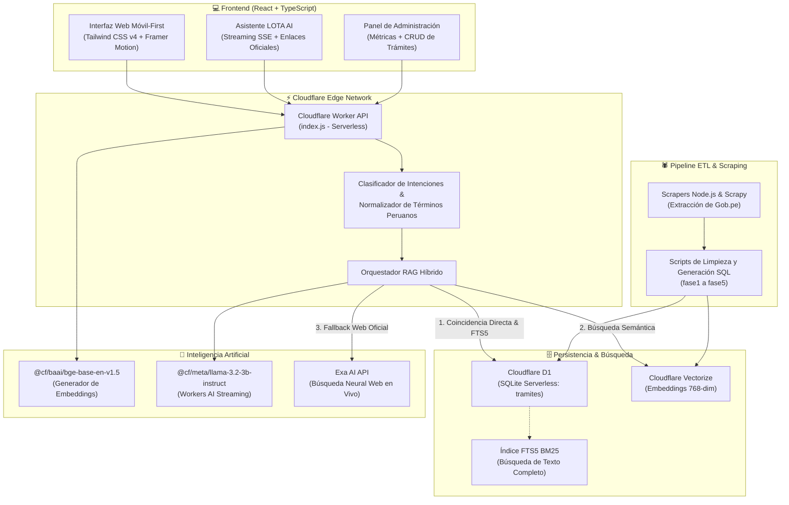

# 🇵🇪 AhorraTiempo con LOTA AI
> **Plataforma Inteligente de Orientación y Consulta de Trámites del Estado Peruano**  
> **Proyecto de Tesis - TECSUP**  
> *Respaldo Técnico Oficial de Entrega*

---

## 📌 1. Visión General del Proyecto

**AhorraTiempo con LOTA AI** es una plataforma web móvil-first y de alta velocidad diseñada para facilitar el acceso, búsqueda y comprensión de los trámites ciudadanos del Estado Peruano (SUNAT, RENIEC, MTC, SUNARP, Banco de la Nación, EsSalud, Migraciones, entre otros).

El proyecto integra **LOTA AI** (*Localizadora y Orientadora de Trámites Ágiles*), una inteligencia artificial especializada con arquitectura **RAG Híbrido** (Retrieval-Augmented Generation) que combina:
1. **Búsqueda léxica ultrarrápida BM25 (SQLite FTS5)** sobre la base de datos oficial.
2. **Búsqueda semántica vectorial (Cloudflare Vectorize + BGE Embeddings)** para entender lenguaje natural y jerga ciudadana peruana.
3. **Modelos de Lenguaje Avanzados (Cloudflare Workers AI - LLaMA 3.2 / Qwen 2.5)** que responden en tiempo real con streaming token-by-token, acompañados de enlaces oficiales verificados y guías paso a paso.

---

## 🏛️ 2. Arquitectura de la Solución



---

## 💻 3. Stack Tecnológico

### 3.1. Frontend
- **Framework Principal:** [React 18](https://react.dev/) + [TypeScript](https://www.typescriptlang.org/)
- **Empaquetador y Bundler:** [Vite 8](https://vitejs.dev/)
- **Estilos y Diseño:** [Tailwind CSS v4](https://tailwindcss.com/)
- **Iconografía:** [Fluent UI React Icons](https://github.com/microsoft/fluentui-system-icons) y [Lucide React](https://lucide.dev/)
- **Animaciones e Interacciones:** [Framer Motion](https://www.framer.com/motion/) y [GSAP](https://greensock.com/gsap/)
- **Notificaciones (Toasts):** [Sonner](https://sonner.emilkowal.ski/)
- **Procesamiento Markdown:** [React Markdown](https://github.com/remarkjs/react-markdown) + [Remark GFM](https://github.com/remarkjs/remark-gfm)
- **Persistencia en Cliente:** LocalStorage con fallback y sincronización Firebase Firestore.

### 3.2. Backend & Edge Computing
- **Plataforma:** [Cloudflare Workers](https://workers.cloudflare.com/) (Serverless en Edge global).
- **Entorno de Ejecución:** JavaScript V8 ES Modules con protocolo Server-Sent Events (SSE) para streaming.
- **Seguridad y Validación:** Whitelist estricta de dominios institucionales (`*.gob.pe`, `sunat.gob.pe`, `reniec.gob.pe`, etc.) y desinfección de parámetros volátiles.

### 3.3. Base de Datos y Motores de Búsqueda
- **Base de Datos Relacional:** [Cloudflare D1](https://developers.cloudflare.com/d1/) (Motor SQLite distribuido).
- **Búsqueda Léxica:** Virtual Table SQLite **FTS5** con ponderación BM25 y triggers de actualización automática.
- **Base de Datos Vectorial:** [Cloudflare Vectorize](https://developers.cloudflare.com/vectorize/) para almacenamiento y cosine similarity search de vectores de 768 dimensiones.
- **Modelo de Embeddings:** `@cf/baai/bge-base-en-v1.5` de Workers AI.

### 3.4. Inteligencia Artificial (LOTA AI)
- **Modelos de Inferencia Principal:**
  - `@cf/meta/llama-3.2-3b-instruct` (Ultra baja latencia para streaming ciudadano).
  - `@cf/meta/llama-3.1-8b-instruct-fp8` (Modelo de precisión con mayor capacidad de contexto).
  - `@cf/qwen/qwen2.5-7b-instruct` (Respaldo alternativo de alta velocidad).
- **Fallback en Vivo:** [Exa AI API](https://exa.ai/) para recuperación de directivas gubernamentales recién publicadas en Gob.pe en caso de no encontrarse localmente.

### 3.5. Pipeline de Scraping y ETL
- **Python:** [Scrapy](https://scrapy.org/) para rastreo concurrente de portales del Estado.
- **Node.js:** Scripts ES Modules (`fase1_catalogo.mjs`, `fase2_extractor_v3_careful.mjs`, `fase3_generate_sql.mjs`, `fase3_sync_vectorize.mjs`) para estructuración profunda de requisitos, consideraciones, pasos y costos.

---

## 📂 4. Estructura del Repositorio

```text
portal-tramites/
├── cloudflare-worker/             # Backend Serverless en Cloudflare Workers
│   ├── index.js                   # API REST, RAG Híbrido, Streaming y Endpoints AI
│   ├── wrangler.toml              # Configuración de Cloudflare D1, Vectorize y AI
│   ├── schema_d1.sql              # DDL maestro de tablas, FTS5 y triggers
│   ├── update_db.sql              # Actualizaciones de enlaces oficiales y costos
│   ├── inject_piloto.sql          # Inserciones iniciales para entorno de prueba
│   ├── embed_remote.py            # Script para extracción y subida de embeddings
│   └── remote_vectors.jsonl       # Dataset de vectores precalculados
├── scrapers/                      # Spiders de Scrapy (Python)
│   ├── ahorratiempo_spiders/      # Proyecto Scrapy para portales públicos
│   ├── sunat_completo.json        # Dataset extraído consolidado
│   └── requirements.txt           # Dependencias de Python
├── scripts/                       # Pipeline ETL modular en Node.js
│   ├── fase1_catalogo.mjs         # Extracción de catálogo de Gob.pe
│   ├── fase2_extractor_v3_careful.mjs # Extractor minucioso de requisitos y pasos
│   ├── fase3_generate_sql.mjs     # Generador de sentencias SQL para D1
│   ├── fase3_populate_d1.sql      # Script SQL de población masiva (594+ trámites)
│   ├── fase3_sync_vectorize.mjs   # Sincronizador de vectores con Cloudflare
│   ├── fase5_e2e_testing.mjs      # Pruebas integrales de flujo
│   └── sunat_tramites_completos.json # Dataset JSON final de trámites
├── src/                           # Código Fuente del Frontend (React + TS)
│   ├── app/
│   │   ├── components/            # Componentes UI (LOTA AI, Header, Footer, Cards)
│   │   ├── pages/                 # Vistas (Inicio, Categorías, Favoritos, Perfil)
│   │   ├── admin/                 # Módulo de Administración (Overview, Trámites, Compradores)
│   │   ├── types.ts               # Definición de tipos TypeScript
│   │   └── data.ts                # Flujos de trámites y configuración
│   ├── styles/                    # Estilos CSS y temas
│   ├── firebase.ts                # Inicialización opcional de Firebase SDK
│   ├── main.tsx                   # Punto de entrada de la aplicación
│   └── index.html                 # Plantilla HTML5
├── public/                        # Recursos estáticos, logos SVG y favicons
├── schema_d1.sql                  # Copia del esquema DDL en la raíz
├── package.json                   # Dependencias y scripts de Node.js
├── vite.config.ts                 # Configuración de Vite y optimización de chunks
├── tsconfig.json                  # Configuración del compilador TypeScript
└── README.md                      # Documentación técnica
```

---

## ⚙️ 5. Guía de Instalación y Ejecución Local

### 5.1. Prerrequisitos
- **Node.js:** Versión 18.0.0 o superior (recomendado Node.js 20 LTS).
- **npm:** Versión 9 o superior.
- **Python (Opcional para scrapers):** Versión 3.10 o superior.
- **Cloudflare Wrangler CLI (Para backend):** Incluido en `npx wrangler`.

---

### 5.2. Puesta en Marcha del Frontend

1. **Instalar dependencias:**
   ```bash
   npm install
   ```

2. **Configurar variables de entorno (Opcional para Firebase):**
   Copiar `.env.example` a `.env`:
   ```bash
   cp .env.example .env
   ```

3. **Iniciar servidor de desarrollo:**
   ```bash
   npm run dev
   ```
   La aplicación se abrirá en `http://localhost:5173`.

4. **Compilar para producción:**
   ```bash
   npm run build
   ```
   Genera la carpeta optimizada `dist/`.

---

### 5.3. Puesta en Marcha del Backend (Cloudflare Worker)

1. **Ingresar a la carpeta del worker:**
   ```bash
   cd cloudflare-worker
   ```

2. **Iniciar el Worker en modo local:**
   ```bash
   npx wrangler dev
   ```
   El backend se ejecutará simulando el entorno de Cloudflare en `http://localhost:8787`.

3. **Desplegar en la nube de Cloudflare (Producción):**
   ```bash
   npx wrangler deploy
   ```

---

## 🗄️ 6. Despliegue de la Base de Datos (Cloudflare D1)

La base de datos utiliza **Cloudflare D1** con soporte de búsqueda FTS5.

### 6.1. Creación de la base de datos
```bash
npx wrangler d1 create ahorratiempo-db
```

### 6.2. Aplicar el esquema DDL (`schema_d1.sql`)
- **En entorno local:**
  ```bash
  npx wrangler d1 execute ahorratiempo-db --local --file=./schema_d1.sql
  ```
- **En producción (Cloudflare Edge):**
  ```bash
  npx wrangler d1 execute ahorratiempo-db --remote --file=./schema_d1.sql
  ```

### 6.3. Cargar la data completa de trámites
```bash
npx wrangler d1 execute ahorratiempo-db --remote --file=../scripts/fase3_populate_d1.sql
```

### 6.4. Reconstruir el índice de texto completo (FTS5)
```bash
npx wrangler d1 execute ahorratiempo-db --remote --command="INSERT INTO tramites_fts(tramites_fts) VALUES('rebuild');"
```

---

## 🌐 7. Endpoints de la API Backend

| Método | Endpoint | Descripción |
|---|---|---|
| `POST` | `/api/ai/chat` | Asistente inteligente LOTA AI con RAG híbrido y streaming SSE. |
| `POST` | `/api/ai/tramite-guide` | Generador automático de checklist interactivo de requisitos. |
| `POST` | `/api/admin/reindex-vectors` | Sincronizador y generador masivo de embeddings hacia Vectorize. |
| `OPTIONS` | `*` | Manejador universal de preflight CORS con orígenes controlados. |

---

## 🎓 8. Información Institucional

- **Institución:** TECSUP
- **Carrera / Departamento:** Tecnología de la Información / Diseño y Desarrollo de Software
- **Proyecto:** AhorraTiempo con LOTA AI
- **Año:** 2026

---
*Este material forma parte del respaldo técnico oficial entregado en soporte físico (CD-ROM / DVD) para la sustentación de tesis.*
